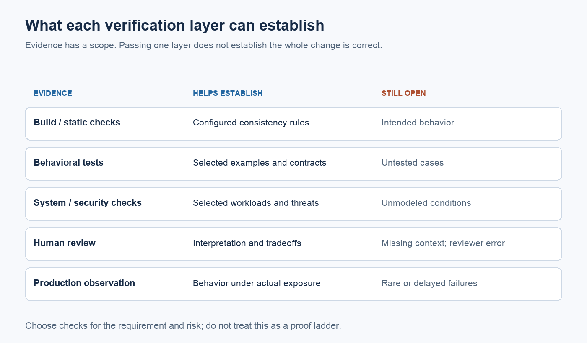
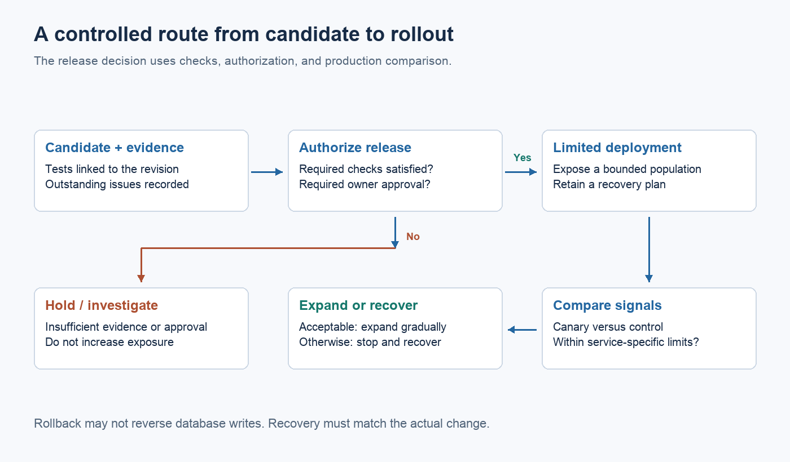

# Software factory: supporting notes

[Main article: Building a software factory: contracts, context, and verification](Draft.md)

These notes retain the detailed project records, technical discussion, and conceptual figures supporting the article. Evaluation outcomes and source-review limits remain scoped to their recorded protocols. No new evaluation was run for this consolidation.

## Workflow contracts

My controller owns workflow routes and accepted outcomes. Agent packages supply the behavior used within those steps. Optional Git hooks prepare worktrees and create stage commits. I can inspect and change those lifecycle operations in ordinary code without relying on an agent to remember them. [Controller documentation](</Users/j/pragma/controls/README.md>) · [Registry documentation](</Users/j/pragma/registry/README.md>)

The current controller documentation says a package completes a step through an accepted MCP `step_result` message. Process exit, an idle turn, or a prose claim of completion cannot advance it.

A completed step may establish that documents were submitted or that a reviewer returned findings. Product acceptance requires its own checks.

Retry limits and timeouts belong with this state management. An unavailable environment needs a different route from a failed behavioral test. An ambiguous requirement needs a decision owner. Repeating an implementation attempt is useful only when the failure gives it something it can resolve.

Dependencies constrain concurrency too. A consumer needs a published input before it can work. If producer and consumer code must migrate together, the compatibility sequence needs to be defined before either change runs. I want to be able to explain that ordering before adding more workers.

Agentless used a constrained issue-repair sequence on its benchmark. That gives me a simpler process to compare with elaborate orchestration on my own tasks. It does not settle which design will work best for the factory. [Agentless](https://arxiv.org/abs/2407.01489)

## Requirements and context

The abstraction I am exploring covers the work between an engineering request and an accepted change. It includes turning the request into a usable specification and plan, supplying context, and deciding how the result will be checked. I still need to understand the implementation well enough to investigate failures in any of those steps.

The task in these evaluations is small enough to describe without a product roadmap. An existing Go service creates tasks through `POST /tasks` and retrieves them through `GET /tasks/{id}`. The change adds an optional `Idempotency-Key` header. Repeating a valid request with the same key and body should return the original response without creating another task.

An absent header preserves the existing behavior. A blank header is an error. Reusing a key with a different body is a conflict, and the comparison is over exact request bytes. Invalid requests must not reserve their keys. Concurrent requests have to obey the same contract. The brief also says to keep the existing Go version and avoid new dependencies unless the task requires them and a human approves. [GO-001 brief](</Users/j/pragma/evals/scenario/brief.md>)

Each of those rules has to reach the implementation and the person or agent assessing it. A plan can be internally consistent and still drop one of them. Tests written from that plan can then agree with the code while missing the original requirement.

I want the specification to give the executor a bounded task and give the reviewer grounds for rejecting a plausible implementation. For this service, that includes preserving existing responses and version constraints. For another API, it might include client compatibility or a latency budget. Stable requirements can become contract tests, with the reasons for those tests retained alongside them.

Context is part of this work. The executor needs to find the current contract and know how to handle an older design document that disagrees with it. Summaries need source links and a refresh date. Someone must own those sources and respond when they become stale.

Larger inputs leave those responsibilities in place. *Lost in the Middle* found position-sensitive performance in the retrieval tasks and older models it studied. A separate evaluation of repository context files found no general task-success improvement and increased inference cost in its tested settings. Both give me reasons to test what guidance helps on the actual work. Neither tells me that a larger prompt or an additional instruction file will fix a missing requirement. [Lost in the Middle](https://arxiv.org/abs/2307.03172) · [Evaluating AGENTS.md](https://arxiv.org/abs/2602.11988)

## Evaluation records and design review

On November 1, my software factory completed a Go coding task. The separate grader passed all ten acceptance cases, then failed the result on `go vet`.

The saved diagnostic identified four uses of an API requiring Go 1.25 or later. The module declared Go 1.22. The workflow had reached its completed state, including review and approval, while the grader still had a reason to reject the candidate. [November 1 result](</Users/j/pragma/evals/runs/GO-001-20261101T211413927528Z-bee829/result.json>) · [Saved vet diagnostic](</Users/j/pragma/evals/runs/GO-001-20261101T211413927528Z-bee829/vet.stderr>)

I have to decide when a check can veto completion and what happens after that veto. Repairing the code creates another candidate, which needs fresh evidence tied to its revision.

The November 14 run went through three specification and architecture-review visits during design. The final architecture review records seven findings as addressed. Those findings included preserving strict JSON validation and keeping idempotency-entry creation conditional on the header being present. [November 14 result](</Users/j/pragma/evals/runs/GO-001-20261114T202629280058Z-578ee3/result.json>) · [Architecture review](</Users/j/pragma/evals/.factory/executions/3141aac4-34cd-40d5-8436-f2552bfc6dfd/files/reviews/architecture.md>)

One correction was especially concrete. The plan told the implementer to run `go test taskapi_test.go`. That invocation omitted the source package definitions the test file depended on. The reviewer recorded the change to `go test .` and reported checking that the corrected command worked.

The review identifies the document revisions and retains the findings used to assess them. It also states its limits: the reviewer was assessing a design before implementation, so the later candidate still needed its own checks.

At the implementation handoff, the corrected plan needs to travel with the verification still outstanding. Another edit can invalidate an earlier check. A statement that the reviewer approved the plan should not close the implementation's verification obligations.

I also need to account for the work review creates. A person receiving an escalation needs the failing check and current diff, with the attempted repairs available for inspection. Asking them to approve an unfamiliar result from a transcript dump gives them a reconstruction task before they can make the decision. Bainbridge's *Ironies of Automation* describes the difficult abnormal conditions left to human operators. That is an old problem with a recognizable place in this workflow. [Ironies of Automation](https://doi.org/10.1016/0005-1098%2883%2990046-8)

## Verification, release, and runtime limits

The November 7 evaluation completed and passed both its acceptance cases and `go vet`. That is a better result on those checks than November 1. It remains evidence about a particular candidate under a particular protocol. [November 7 result](</Users/j/pragma/evals/runs/GO-001-20261107T160953628967Z-8271ed/result.json>)

The November 14 evaluation has a different limit. Its newer harness uses Factory's public interface and does not open the product workspace to run a local grader. The workflow completed, but the result records independent product grading as unavailable because that interface does not expose the required acceptance operation. Reviewer reports remain attributed assessments. Pooling this result with the older locally graded runs would obscure a change in what was measured. [Evaluation protocol and limits](</Users/j/pragma/evals/README.md>)

I need the factory to report that gap. An unavailable check leaves an obligation open, even if every configured workflow step has completed.

*Verification map: checks establish scoped claims, not complete correctness. Informed by [NIST SSDF](https://csrc.nist.gov/pubs/sp/800/218/final) and [Gu et al.](https://arxiv.org/pdf/2503.22625).*

[Figure sources and methodology](writing/eng/posts/engineering%20the%20factory/images/Figure%20sources.md)

| Evidence | What it helps establish | What remains open |
| --- | --- | --- |
| Build and static checks | Basic consistency with configured rules | Intended behavior |
| Unit and contract tests | Specified behavior at selected boundaries | Untested cases and combined changes |
| System and security checks | Selected operational properties | Conditions the checks don't model |
| Human review | Interpretation and consequential tradeoffs | Human mistakes and missing context |
| Controlled production rollout | Behavior under actual use | Rare or delayed failures |

Run cheap mechanical checks early, then choose additional evidence according to the change. Behavioral and security questions need checks that exercise those properties. AI review can contribute findings, but shared assumptions between the generator and reviewer can leave the same error intact. SWE-bench's executable issue-repair evaluation is useful within its stated boundary; a release decision has additional obligations. [SWE-bench](https://pli.princeton.edu/blog/2023/swe-bench-can-language-models-resolve-real-world-github-issues)

Delivery extends the problem beyond the repository. A candidate can pass preproduction checks and behave differently under real traffic. Where the service permits a canary, a limited release provides a comparison before exposure widens. The team still needs to decide which signals would stop the rollout and what recovery can accomplish. A rollback command may leave database writes behind. [Canarying releases](https://sre.google/workbook/canarying-releases/)

*Proposed rollout workflow based on [NIST SSDF](https://csrc.nist.gov/pubs/sp/800/218/final) and [Google SRE](https://sre.google/workbook/canarying-releases/). Recovery depends on the change; rollback is not always sufficient.*

[Figure sources and methodology](writing/eng/posts/engineering%20the%20factory/images/Figure%20sources.md)

My local runner uses the host user's permissions and is documented as not being a sandbox. A task description limiting an agent to a checkout does not establish isolation. Identity and audit records are necessary, and mandatory restrictions need enforcement at the tool or deployment boundary. That remains an operating limit of the project. [Runner limits](</Users/j/pragma/controls/README.md>)

Secure-development responsibilities also survive a workflow redesign. NIST's SSDF version 1.1 describes practices that can be integrated into different lifecycles. I can use that guidance when designing the process; it does not certify the resulting factory. [NIST SP 800-218](https://csrc.nist.gov/pubs/sp/800/218/final)

## Resource accounting

The November 1 report records about 20.15 million tokens. November 7 records about 5.04 million. Both report dollar cost as unknown. The input variants differ, and these are individual runs, so the lower count cannot establish an efficiency improvement or identify its cause.

November 14 reports about 7.97 million tokens, also without a dollar total. Its protocol differs from the earlier runs. The reported accounting includes input, cached reads and writes, and output; I cannot convert the combined count into a bill by applying one token price. [November 14 accounting](</Users/j/pragma/evals/runs/GO-001-20261114T202629280058Z-578ee3/factory-report.json>)

Even a complete model bill would cover only part of the cost. I want to count time spent specifying the work and reviewing it, the repairs after failed checks, and the maintenance of the factory itself. Failed tasks consume resources too. After delivery, escaped defects and recovery work belong in the same assessment.

I want to find out whether this abstraction makes subsequent changes easier to specify, verify, and maintain, and whether it lets me take on more complicated work. A recurring failure might justify better context or a tool change. It might belong in an acceptance test. Each proposed improvement needs representative tasks that show whether it helps and whether it damages other work.

A first workflow could handle routine dependency updates in one service. Define the permitted versions and update policy, require a patch and dependency-change record with named check results, and keep the existing release authorization. An update requiring application redesign goes back to a person. Give the workflow an owner who maintains its environment and investigates failures.

I expect that boundary to change as the project develops. The current evaluation leaves me with a specific interface to build: a supported independent acceptance check whose result identifies the candidate revision. The November 14 run cannot supply that evidence.

## Conceptual topic map

[Figure notes](writing/eng/posts/engineering%20the%20factory/images/Figure%20sources.md)

## Research and scope

Project evidence was reviewed on November 16, 2026, using the current `/Users/j/pragma/evals` directory and the Controls and Registry documentation. The November 1 and November 7 results use the historical local-grading protocol. The November 14 result uses protocol 2, which reports independent product verification as unavailable through the public interface. Stored reviewer findings are attributed to their reviewers. No factory execution or product test was run for this article revision.

These records do not establish general reliability, productivity gains, or ROI. The dependency-update workflow and diagrams are design proposals. Benchmarks and older automation research support specific concerns without validating the factory as a whole. The external research summaries retain the scope of the earlier source review; this revision makes no new claim about standards status. Local project links need reviewed, publishable equivalents before external publication. See [References.md](References.md) for the evidence and its limits.
